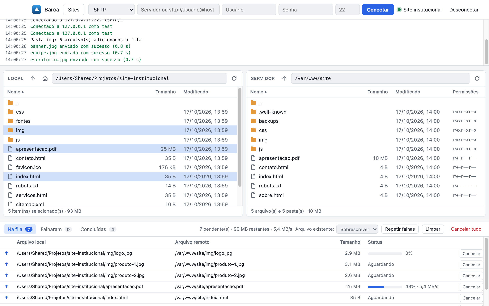

[English](README.md) · [Português (BR)](README.pt-BR.md) · [Español](README.es.md)

# Barca

Cliente FTP, FTPS y SFTP moderno para macOS, nativo para Apple Silicon.

Gestor de archivos de dos paneles (local ⇄ servidor), cola de transferencias,
gestor de sitios y registro de operaciones — hecho con Electron, Node.js y
HTML5/CSS/JavaScript puro.

<picture>
  <source media="(prefers-color-scheme: dark)" srcset="docs/screenshot-dark.png">
  
</picture>

## Funcionalidades

- **Protocolos:** SFTP (contraseña o clave privada), FTPS (explícito e implícito) y FTP
- **Dos paneles:** columnas ordenables, selección múltiple (⌘/⇧), navegación con teclado, ruta editable
- **Arrastrar y soltar:** entre los paneles o desde el Finder directamente al servidor
- **Cola de transferencias:** 2 conexiones en paralelo, carpetas recursivas, progreso y
  velocidad, cancelar, reintentar, sobrescribir u omitir archivos existentes
- **Operaciones remotas:** nueva carpeta, renombrar, eliminar, permisos (chmod), copiar ruta
- **Gestor de sitios:** contraseñas cifradas con el Llavero de macOS (`safeStorage`)
- **Seguridad:** confirmación de la huella digital de la clave SSH y alerta de cambio;
  aviso al usar FTP sin cifrado
- Tema claro/oscuro automático

## Ejecución local

Requisitos: macOS 12+, Node.js 20+

```bash
npm install
npx install-electron   # descarga el binario de Electron (npm 12+ bloquea los scripts de instalación)
npm start
```

## Generar la aplicación

```bash
npm run icon   # genera build/icon.icns a partir de build/icon.svg
npm run dist   # genera dist/Barca-darwin-arm64/Barca.app
```

La aplicación generada tiene una firma ad-hoc. Para distribuirla a otros Mac
sin avisos de Gatekeeper, fírmela con un Developer ID y notarícela.

## Estructura del proyecto

```
src/main/       proceso principal (Node.js)
  main.js       ventana, IPC, verificación de claves del servidor
  remote.js     cliente unificado FTP/FTPS/SFTP
  queue.js      cola de transferencias
  store.js      sitios guardados y claves SSH de confianza
  preload.js    puente seguro entre el proceso principal y la interfaz
src/renderer/   interfaz (HTML5, CSS, JavaScript)
```

## Stack

Electron · Node.js · [basic-ftp](https://github.com/patrickjuchli/basic-ftp) ·
[ssh2-sftp-client](https://github.com/theophilusx/ssh2-sftp-client) · HTML5 · CSS · JavaScript

## Licencia

Barca se distribuye bajo **doble licencia**:

- [AGPLv3](LICENSE) — gratuita, siempre que cualquier versión modificada
  (incluido su uso como servicio en red) también se ponga a disposición bajo
  la misma licencia.
- [Licencia comercial](COMMERCIAL-LICENSE.es.md) — una garantía, no un
  producto: vender Barca o usarla en software de código cerrado requiere la
  autorización expresa del mantenedor.

Las contribuciones están sujetas a los términos de [CONTRIBUTING.es.md](CONTRIBUTING.es.md).

Las dependencias de terceros conservan sus propias licencias (MIT, Apache-2.0,
BSD-3-Clause, ISC, Unlicense), todas compatibles con ambas opciones de licencia.

Copyright © 2026 Roger Philippe Pereira
